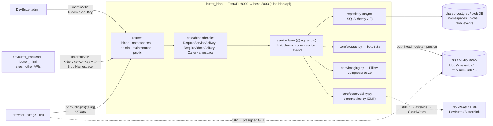
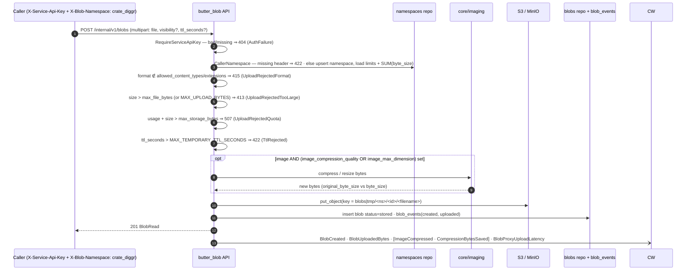
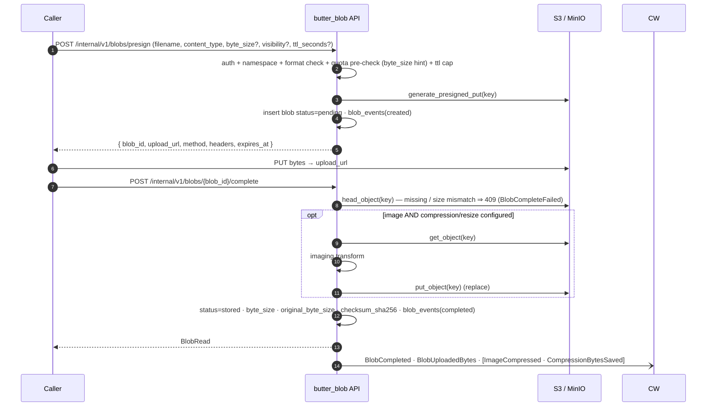
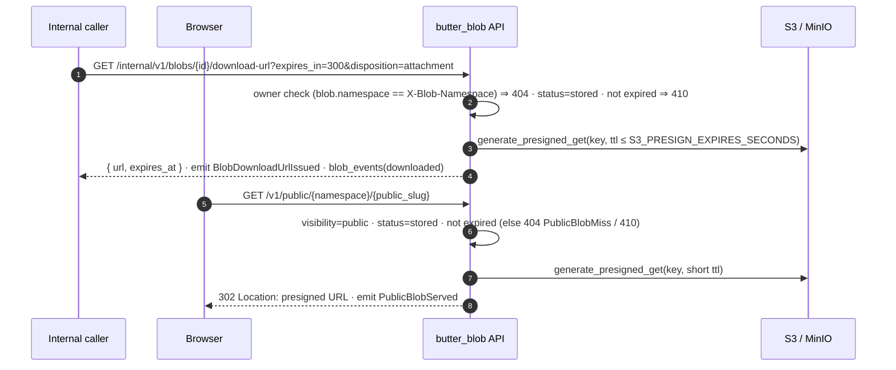
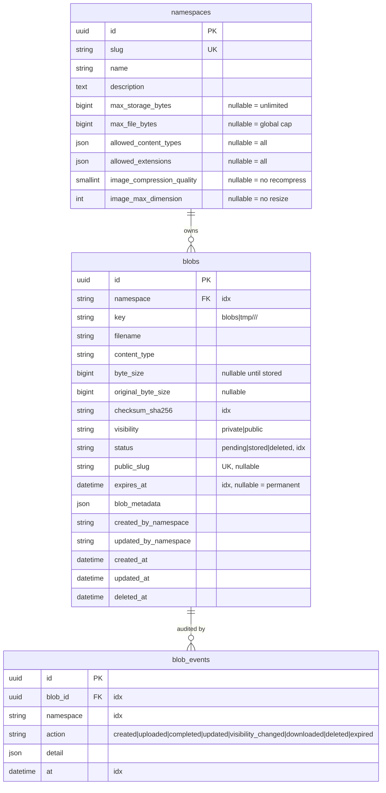

# butter_blob — Specification

**Status:** authoritative. Code that disagrees with this document is a bug in the
code unless the change is deliberate (then update this document in the same slice).

---

## 1. Purpose & scope

DevButter runs several FastAPI microservices on a shared Postgres and a shared
Docker network (`devbutter_shared`). None of them can persist a file. `butter_blob`
is the one service that stores and serves files (**blobs**) for all of them.

**In scope (phase 1, prompts 00–11):**

- Upload a blob — direct multipart proxy upload, or a presigned S3 PUT confirmed
  with `/complete`.
- Bind every blob to the **namespace** (calling API) that created it; only that
  namespace can read/edit/download/delete it.
- Per-namespace limits set by a DevButter admin: total storage quota, max file
  size, allowed formats (MIME + extension), image compression quality and max
  dimension.
- Serve blobs: short-lived presigned download URLs for owners; a stable public
  URL for blobs marked `public` (the "front door" for website assets).
- Temporary blobs: a `ttl_seconds` on upload makes the blob auto-expire; expired
  reads return `410`; a maintenance endpoint reclaims the storage.
- Audit: every state change is recorded in `blob_events`.
- CloudWatch EMF metrics: request-level + file-level.

**Phase 2 (prompts 12–16), previously "out of scope", now planned:**

- Per-namespace DB-backed bearer API keys (relay-style).
- Async post-processing worker: virus scan, image thumbnails, video transcode.
- `devbutter_backend` client for butter_blob.
- CDN / custom domain in front of `/v1/public/*`.
- HTML admin dashboard.

**Not planned:** anything not listed above.

---

## 2. Concepts

| Term | Meaning |
|---|---|
| **blob** | One stored file. Identified by a UUID. Has bytes in S3 and a metadata row in Postgres. |
| **namespace** | The identifier of the app/API that owns a set of blobs (e.g. `crate_diggr`, `devbutter_backend`). Sent on every internal request as `X-Blob-Namespace`. Also the unit an admin configures limits on. |
| **visibility** | `private` (default — reachable only by the owner namespace, via presigned URL) or `public` (reachable by anyone at a stable path). |
| **status** | `pending` (row created, bytes not yet confirmed), `processing` (stored and queued), `stored` (ready), `deleted` (soft-deleted or quarantined). |
| **temporary blob** | A blob with `expires_at` set. Stored under the `tmp/` key prefix. Reads after `expires_at` return `410`. |
| **blob event** | An append-only audit record: which namespace did what to a blob, when. |

---

## 3. Diagrams

### 3.1 Components & auth trees

### 3.2 Proxy upload — limit enforcement + image compression

### 3.3 Presigned upload + complete

### 3.4 Async post-processing

After proxy upload or `/complete`, eligible blobs transition to `processing` and
an SQS job contains `blob_id`, `namespace`, and enabled kinds. The API never
waits for the job. The worker acknowledges only successful messages; a failure
uses SQS visibility-timeout retry/DLQ semantics. ClamAV positives are
soft-deleted, removed from storage, and audited as `quarantined`; thumbnails are
WebP sidecars recorded in `blob_metadata.derived`.

### 3.4 Download — private (owner) and public

### 3.5 Blob lifecycle (status + expiry)

```mermaid
stateDiagram-v2
    [*] --> pending: presign
    [*] --> stored: proxy upload
    pending --> stored: complete (head_object OK)
    pending --> deleted: DELETE / abandoned
    stored --> stored: PATCH (visibility, metadata, extend TTL)
    stored --> expired: now > expires_at (temporary)
    expired --> [*]: read ⇒ 410 ExpiredBlobRequested
    stored --> deleted: DELETE (soft ⇒ status=deleted; hard ⇒ row+object gone)
    expired --> deleted: POST /internal/v1/maintenance/purge-expired
    deleted --> [*]
```

### 3.6 Data model

---

## 4. Identities & auth

Three route trees, each with its own guard (all in `app/core/dependencies.py`):

### 4.1 `/v1/public/*` — open
No auth. Serves only blobs with `visibility=public` and `status=stored` that are
not expired. Read-only.

### 4.2 `/internal/v1/*` — service callers
The preferred identity is **`Authorization: Bearer bbk_...`**. Each key belongs
to one namespace, is persisted only as a SHA-256 hash, and is revocable through
the admin API. It supplies the caller namespace; if `X-Blob-Namespace` is also
sent, it must normalize to the key's namespace or the request is **403**.

During migration, `ALLOW_HEADER_NAMESPACE=true` permits the legacy
`X-Service-Api-Key` + `X-Blob-Namespace` path. Its missing/wrong shared key is
**404**; when the setting is false, header-only identity is **404**. The header
namespace remains normalized and upserted on first use.

Every blob-scoped route runs `_require_owner(blob, namespace)` → **404** if
`blob.namespace != namespace`. There is no way for one namespace to see another's
blobs.

### 4.3 `/admin/v1/*` — DevButter admin
**`X-Admin-Api-Key`** — must equal `settings.admin_api_key`. Missing/wrong ⇒ **404**
+ `AuthFailure` (`Reason=admin_api_key`). Admin routes set per-namespace limits and
can inspect any namespace's usage.

### 4.4 `/admin` — session dashboard
The server-rendered dashboard uses a signed `butter_blob_admin` session cookie.
Unauthenticated page requests redirect (303) to `/admin/login`. It can inspect
all blobs, edit the same namespace-limit service used by `/admin/v1/*`, and
soft-delete blobs. Each namespace page can create a bearer key (shown once in a
`no-store` response) and revoke an active key. The header-authenticated JSON
API remains unchanged.

---

## 5. Per-namespace limits (admin-controlled)

Columns on the `namespaces` row. All nullable; `NULL` means "no limit of this kind".

| Field | Type | Meaning | `NULL` behaviour |
|---|---|---|---|
| `max_storage_bytes` | bigint | Cap on `SUM(byte_size)` of the namespace's `stored` blobs. | unlimited |
| `max_file_bytes` | bigint | Per-file cap for this namespace. | fall back to global `MAX_UPLOAD_BYTES` |
| `allowed_content_types` | json array of str | Allowed MIME types, lowercased (e.g. `["image/png","application/pdf"]`). | all allowed |
| `allowed_extensions` | json array of str | Allowed lowercased extensions incl. dot (`[".png",".pdf"]`). | all allowed |
| `image_compression_quality` | smallint 1–100 | JPEG/WebP quality applied to uploaded images. | no recompression |
| `image_max_dimension` | int | Max width/height in px, aspect preserved. | no resize |

### 5.1 Enforcement ladder (on `POST /internal/v1/blobs`, `/presign`, `/complete`)

Checked in this order; first failure wins:

1. **Format** — if `allowed_content_types` is set and the content type isn't in it,
   **or** `allowed_extensions` is set and the filename's extension isn't in it ⇒
   **415** `UnsupportedMediaTypeError` + `UploadRejectedFormat`.
2. **File size** — effective per-file cap is `max_file_bytes` if set else
   `MAX_UPLOAD_BYTES`. Over ⇒ **413** `PayloadTooLargeError` + `UploadRejectedTooLarge`.
   (On `/presign` the check uses the caller-supplied `byte_size` hint if present;
   `/complete` re-checks the real `head_object` size.)
3. **Storage quota** — if `max_storage_bytes` is set and
   `SUM(byte_size of stored blobs) + new_size > max_storage_bytes` ⇒ **507**
   `QuotaExceededError` + `UploadRejectedQuota`.
4. **TTL** — `ttl_seconds > MAX_TEMPORARY_TTL_SECONDS` ⇒ **422** + `TtlRejected`.

### 5.2 Image compression pipeline (`app/core/imaging.py`, Pillow)

`transform(data, content_type, *, quality, max_dimension) -> (bytes, out_content_type)`:

- Non-image content types, or `quality`/`max_dimension` both unset ⇒ passthrough.
- Resize: `Image.thumbnail((max_dimension, max_dimension))` (aspect kept, only
  shrinks).
- Recompress: `save(..., quality=quality, optimize=True)`. JPEG stays JPEG; PNG
  with `quality` set is re-encoded as WebP (documented; `out_content_type` reflects
  it and `filename`/`key` get a `.webp` suffix). Guard `Image.MAX_IMAGE_PIXELS`
  (decompression-bomb protection) → oversized ⇒ **415**.
- **Proxy upload:** transform in-process before `put_object`.
- **Presigned upload:** bytes land raw; `/complete` does
  `get_object → transform → put_object` (replace) when the namespace has
  compression/resize configured and the object is an image. This is a documented
  extra S3 round-trip.
- The blob records `original_byte_size` (pre-transform) and `byte_size`
  (post-transform); metrics `ImageCompressed` (Count) and `CompressionBytesSaved`
  (Bytes = original − new).

---

## 6. Storage layout

- **Bucket:** `settings.s3_bucket` (`devbutter-blob-local` in dev). One bucket for
  everything; namespace isolation is by key prefix + the DB owner check, not by
  bucket.
- **Key:** `blobs/<namespace>/<blob_id>/<filename>` for permanent blobs,
  `tmp/<namespace>/<blob_id>/<filename>` for temporary ones. `filename` is
  sanitized (basename only, `[A-Za-z0-9._-]`, non-empty, ≤ 200 chars; fallback
  `file`).
- **Access:** all reads by internal callers and by the public routes go through a
  short-lived **presigned GET** URL (`≤ S3_PRESIGN_EXPIRES_SECONDS`). butter_blob
  never streams bytes on download. Uploads are either streamed through butter_blob
  (proxy) or done straight to S3 with a **presigned PUT**.
- **`core/storage.py` `BlobStorage`** is the only module that imports boto3. Every
  call runs in a worker thread (`asyncio.to_thread`). `botocore` errors become
  `StorageError` (+ `StorageErrorCount` metric with an `Operation` dimension);
  a missing object on `head_object` becomes `NotFoundError`.

---

## 7. Data model

Tables in the `blob` database (own logical DB + role on `shared-postgres`).
Conventions: UUID pk `default=uuid.uuid4`; enums are `str, enum.Enum` in
`String(20)` columns; `DateTime(timezone=True)`; creation timestamps
`server_default=func.now()`.

### 7.1 `namespaces`
`id` uuid pk · `slug` `String(100)` **unique** · `name` `String(200)` ·
`description` `Text` nullable · the six limit columns from §5 · `created_at` ·
`updated_at` (`onupdate=func.now()`).

### 7.2 `blobs`
| Column | Type | Notes |
|---|---|---|
| `id` | uuid | pk |
| `namespace` | `String(100)` | **indexed**; soft ref to `namespaces.slug` |
| `key` | `String(1024)` | S3 object key |
| `filename` | `String(512)` | original (sanitized) |
| `content_type` | `String(255)` | effective (post-compression) |
| `byte_size` | `BigInteger` | nullable until `stored` |
| `original_byte_size` | `BigInteger` | nullable; set when compression ran |
| `checksum_sha256` | `String(64)` | nullable, **indexed** |
| `visibility` | `String(20)` | `private` \| `public`, default `private` |
| `status` | `String(20)` | `pending` \| `processing` \| `stored` \| `deleted`, default `pending`, **indexed** |
| `public_slug` | `String(160)` | nullable, **unique** |
| `expires_at` | `DateTime(tz)` | nullable = permanent, **indexed** |
| `blob_metadata` | `JSON` | default `dict`; arbitrary tags from the owner. Serialized as `metadata` in API schemas. |
| `created_by_namespace` | `String(100)` | |
| `updated_by_namespace` | `String(100)` | nullable |
| `created_at` / `updated_at` / `deleted_at` | `DateTime(tz)` | `deleted_at` nullable |

Constraints: `UniqueConstraint("namespace", "key", name="uq_blob_namespace_key")`;
`public_slug` unique.

`is_temporary` is a computed property (`expires_at is not None`), not a column.

### 7.3 `blob_events`
`id` uuid pk · `blob_id` uuid FK→`blobs.id` **indexed** · `namespace` `String(100)`
**indexed** · `action` `String(30)` (`created`, `uploaded`, `completed`, `updated`,
`visibility_changed`, `downloaded`, `deleted`, `expired`, `processing`, `processed`,
`quarantined`) · `detail` `JSON` default
`dict` · `at` `DateTime(tz)` `server_default=func.now()` **indexed**.

---

## 8. API reference

Common error body: `{"detail": "<message>"}`. Validation errors from FastAPI/Pydantic
use the standard 422 body.

### 8.1 Meta (open)
| Method | Path | Response |
|---|---|---|
| GET | `/health` | `200 {"status":"ok"}` |
| GET | `/health/ready` | `200` if `SELECT 1` **and** S3 `head_bucket` succeed; else `503` + `HealthCheckFailure` metric (`Check=database\|storage`) |
| GET | `/` | `307` → `/docs` (not in schema) |

### 8.2 Internal — `/internal/v1/*`
Headers on every route: `X-Service-Api-Key`, `X-Blob-Namespace`.

#### Blobs
| Method | Path | Body / query | Success | Errors |
|---|---|---|---|---|
| POST | `/internal/v1/blobs` | `multipart/form-data`: `file` (required), `visibility` (`private`\|`public`, default `private`), `filename` (override), `metadata` (JSON string), `ttl_seconds` (int) | `201 BlobRead` | 415, 413, 507, 422 |
| POST | `/internal/v1/blobs/presign` | JSON `PresignRequest`: `filename`, `content_type`, `byte_size?`, `visibility?`, `metadata?`, `ttl_seconds?` | `201 PresignResponse` `{blob_id, upload_url, method:"PUT", headers, expires_at}` | 415, 413, 507, 422 |
| POST | `/internal/v1/blobs/{id}/complete` | — | `200 BlobRead` | 404 (unknown/other namespace), 409 (`BlobCompleteFailed` — object missing or size mismatch) |
| GET | `/internal/v1/blobs` | query: `visibility`, `status`, `checksum_sha256`, `temporary` (bool), `expired` (bool), `created_after`, `created_before`, `limit` (default 100, max 500) | `200 list[BlobRead]` (namespace-scoped) | — |
| GET | `/internal/v1/blobs/{id}` | — | `200 BlobRead` | 404, 410 (expired) |
| GET | `/internal/v1/blobs/{id}/download-url` | query: `expires_in` (default `S3_PRESIGN_EXPIRES_SECONDS`, clamped), `disposition` (`inline`\|`attachment`) | `200 {"url": ..., "expires_at": ...}` | 404, 410 |
| GET | `/internal/v1/blobs/{id}/events` | — | `200 list[BlobEventRead]` (newest first) | 404 |
| PATCH | `/internal/v1/blobs/{id}` | JSON `BlobPatch`: `visibility?`, `filename?`, `metadata?` (shallow-merge), `expires_at?` (ISO-8601 or `null` to clear; capped at `MAX_TEMPORARY_TTL_SECONDS` from now) | `200 BlobRead` | 404, 410, 422 |
| DELETE | `/internal/v1/blobs/{id}` | query: `hard` (bool, default false) | `204` | 404 |

`BlobRead`: `id`, `namespace`, `filename`, `content_type`, `byte_size`,
`original_byte_size`, `checksum_sha256`, `visibility`, `status`, `public_slug`,
`public_url` (when `visibility=public`: `{PUBLIC_BASE_URL}/v1/public/{namespace}/{public_slug}`),
`is_temporary`, `expires_at`, `metadata`, `created_at`, `updated_at`.

#### Namespaces (self-service)
| Method | Path | Notes |
|---|---|---|
| GET | `/internal/v1/namespaces/{slug}` | Own namespace only (`slug` must equal the caller) ⇒ else 404. Returns `NamespaceUsageRead` (limits + `blob_count`, `total_bytes`, `temporary_count`). |
| PATCH | `/internal/v1/namespaces/{slug}` | Own `name` / `description` only. Limits are admin-only. |

#### Maintenance
| Method | Path | Notes |
|---|---|---|
| POST | `/internal/v1/maintenance/purge-expired` | query: `namespace?` (restrict), `older_than_seconds?` (grace beyond `expires_at`). Hard-deletes expired blobs (row + object), writes `blob_events(expired)`, returns `PurgeResult {scanned, purged, bytes_reclaimed}`. Idempotent — safe for a cron/EventBridge schedule. Emits `TemporaryBlobsPurged`, `TemporaryPurgedBytes`. |

### 8.3 Admin — `/admin/v1/*`
Header: `X-Admin-Api-Key`.

| Method | Path | Notes |
|---|---|---|
| GET | `/admin/v1/namespaces` | List all namespaces + usage. |
| GET | `/admin/v1/namespaces/{slug}` | One namespace, full `NamespaceUsageRead` (limits + usage). `404` if unknown. |
| POST | `/admin/v1/namespaces` | Pre-create a namespace with `slug`, `name?`, `description?`, and any limit fields. `409` on duplicate slug. |
| PUT | `/admin/v1/namespaces/{slug}/limits` | Set the six limit fields (`NamespaceLimitsUpdate`, all optional; omitted = unchanged, explicit `null` = clear). Validated: `image_compression_quality` 1–100, byte caps ≥ 0, MIME/extension lists lowercased & de-duplicated. `404` if the namespace doesn't exist yet (use POST first). |

### 8.4 Open — `/v1/public/*`
No auth.

| Method | Path | Success | Errors |
|---|---|---|---|
| GET | `/v1/public/{namespace}/{public_slug}` | `302` → object URL (see CDN note). query: `disposition` (`inline`\|`attachment`). Emits `PublicBlobServed`. `Cache-Control: public, max-age=86400` for permanent public blobs, `no-store` for temporary. | `404` (`PublicBlobMiss` — unknown, not public, or `status != stored`), `410` (expired) |
| GET | `/v1/public/{namespace}/{public_slug}/meta` | `200 {"filename","content_type","byte_size","created_at","expires_at"}` + same `Cache-Control` | `404`, `410` |

#### CDN / custom domain (prompt 15)

**Decision — B: CloudFront in front of the private S3 bucket via Origin Access
Control.** When `PUBLIC_CDN_BASE_URL` is set, the public route returns a stable
`f"{PUBLIC_CDN_BASE_URL}/{blob.key}"` for a **permanent** `stored` public blob
instead of a presigned S3 URL; CloudFront reads the object through OAC and the
bucket stays private. The cache key is the object key (plus
`response-content-disposition`), so a permanent blob is cached at the edge for
its full `max-age`. **Temporary** public blobs keep the short-lived presigned
MinIO/S3 URL and are served `no-store` — never cached.

Option A (CloudFront in front of the service) was rejected: the public route
returns a `302` to a short-lived presigned URL and does not stream bytes, so
caching the redirect is near useless.

Invalidation: `app/core/cdn.py::invalidate(paths)` issues a CloudFront
`create_invalidation` (no-op unless both `PUBLIC_CDN_BASE_URL` and
`CLOUDFRONT_DISTRIBUTION_ID` are set) on `DELETE`, visibility→`private`, and
content replace (`/complete`) of a blob that has a `public_slug`. Invalidation
failures are logged, never surfaced — the storage change already succeeded.

Local dev has no CDN: both settings are empty, everything stays on presigned
MinIO URLs. Terraform for the edge lives in `../infra/terraform/staging/cdn_blob.tf`
(see `docs/terraform-notes.md`).

---

## 9. Metrics catalogue — CloudWatch EMF

Namespace `DevButter/ButterBlob`, service `butter-blob`, log group
`/ecs/devbutter/staging/blob`. `configure_metrics()` forces the `"Local"` stdout
sink (metrics ship via the `awslogs` driver → CloudWatch Logs auto-extraction).
Every emission carries coarse dimensions `{Environment, Service}` plus the
per-call dimensions below. Telemetry failures never affect a request.

### 9.1 Request-level (`RequestContextMiddleware`)
| Metric | Unit | Dimensions |
|---|---|---|
| `RequestCount` | Count | `Method`, `Route` (template), `StatusClass` |
| `Latency` | Milliseconds | same |
| `4xxCount` / `5xxCount` | Count | same |

### 9.2 File-level (service layer, via `emit_blob_metric`)
Every metric here carries a `Namespace` dimension.

| Metric | Unit | Trigger | Extra dims |
|---|---|---|---|
| `BlobCreated` | Count | blob row created (proxy or presign) | `Visibility`, `Temporary` |
| `BlobUploadedBytes` | Bytes | proxy stored / `complete` confirmed | `Temporary` |
| `BlobProxyUploadLatency` | Milliseconds | proxy stream-to-S3 duration | — |
| `BlobCompleted` | Count | presigned upload confirmed | — |
| `BlobCompleteFailed` | Count | `head_object` missing / size mismatch | `Reason` |
| `BlobDownloadUrlIssued` | Count | `/download-url` | `Visibility` |
| `PublicBlobServed` | Count | `/v1/public/...` 302 | — |
| `PublicBlobMiss` | Count | public lookup 404/410 | `Reason` |
| `BlobUpdated` | Count | PATCH applied | — |
| `BlobVisibilityChanged` | Count | visibility flipped | `To` |
| `BlobDeleted` | Count | delete | `Mode` (`soft`/`hard`) |
| `BlobDeletedBytes` | Bytes | delete of a `stored` blob | — |
| `UploadRejectedTooLarge` | Count | 413 | — |
| `UploadRejectedFormat` | Count | 415 | — |
| `UploadRejectedQuota` | Count | 507 | — |
| `TtlRejected` | Count | 422 (ttl over cap) | — |
| `ExpiredBlobRequested` | Count | read of an expired blob → 410 | — |
| `ImageCompressed` | Count | imaging transform ran | — |
| `CompressionBytesSaved` | Bytes | `original_byte_size − byte_size` | — |
| `TemporaryBlobsPurged` | Count | `purge-expired` run | — |
| `TemporaryPurgedBytes` | Bytes | `purge-expired` run | — |
| `StorageErrorCount` | Count | botocore error → `StorageError` | `Operation` (no `Namespace`) |
| `AuthFailure` | Count | bad/missing service or admin key | `Reason` (no `Namespace`) |
| `HealthCheckFailure` | Count | `/health/ready` failed | `Check` (no `Namespace`) |

---

## 10. Configuration (`app/settings/config.py`)

| Setting | Env | Default | Notes |
|---|---|---|---|
| `environment` | `ENVIRONMENT` | `development` | `development`/`staging`/`preprod`/`production` |
| `debug` | `DEBUG` | `false` | |
| `log_level` | `LOG_LEVEL` | `INFO` | |
| `database_host` / `port` / `user` / `password` / `name` | `DATABASE_HOST` / `PORT` / `USER` / `PASSWORD` / `NAME` | `shared-postgres` / `5432` / `blob` | Pydantic assembles `postgresql+asyncpg://` |
| `service_api_key` | `SERVICE_API_KEY` | `""` | `/internal/v1/*` |
| `admin_api_key` | `ADMIN_API_KEY` | `""` | `/admin/v1/*` |
| `session_secret` | `SESSION_SECRET` | `dev-insecure-change-me` | signs `/admin` sessions |
| `session_cookie_name` | `SESSION_COOKIE_NAME` | `butter_blob_admin` | `/admin` session cookie |
| `allow_header_namespace` | `ALLOW_HEADER_NAMESPACE` | `true` | migration window for shared-key + namespace headers |
| `aws_region` | `AWS_REGION` | `us-east-1` | |
| `s3_bucket` | `S3_BUCKET` | `devbutter-blob-local` | |
| `s3_endpoint_url` | `S3_ENDPOINT_URL` | `None` | `http://minio:9000` locally |
| `s3_force_path_style` | `S3_FORCE_PATH_STYLE` | `true` | required for MinIO; `false` on AWS |
| `s3_presign_expires_seconds` | `S3_PRESIGN_EXPIRES_SECONDS` | `900` | ceiling for presigned URL lifetimes |
| `max_upload_bytes` | `MAX_UPLOAD_BYTES` | `52428800` | global per-file ceiling (50 MiB) |
| `default_temporary_ttl_seconds` | `DEFAULT_TEMPORARY_TTL_SECONDS` | `86400` | applied when `temporary` requested with no explicit ttl |
| `max_temporary_ttl_seconds` | `MAX_TEMPORARY_TTL_SECONDS` | `604800` | ttl cap; over ⇒ 422 |
| `public_base_url` | `PUBLIC_BASE_URL` | `http://localhost:8003` | base for `public_url` in responses |
| `public_cdn_base_url` | `PUBLIC_CDN_BASE_URL` | `""` | when set, permanent public blobs are served as `f"{value}/{key}"` (CloudFront); temporary blobs keep presigned URLs. See §8.4 CDN note. |
| `cloudfront_distribution_id` | `CLOUDFRONT_DISTRIBUTION_ID` | `""` | distribution to `create_invalidation` against on delete / visibility→private / replace; empty ⇒ `cdn.invalidate` is a no-op |

`AWS_ACCESS_KEY_ID` / `AWS_SECRET_ACCESS_KEY` are read by boto3 directly (dev:
`minioadmin` / `minioadmin`; AWS: the ECS task role). `AWS_EMF_*` are read in
`core/metrics.py` via `os.getenv`; keep `AWS_EMF_ENVIRONMENT=Local` everywhere.

---

## 11. Non-functional

- **Isolation:** own `blob` database + role on `shared-postgres`; own S3 bucket in
  AWS. No cross-service DB access.
- **Tenancy:** enforced in the app (owner check on every blob route), not by DB
  row-level security.
- **Concurrency:** uniqueness (`namespace,key`; `public_slug`) enforced by DB
  constraints; the repository translates `IntegrityError` → `ConflictError`.
- **Migrations:** run as `alembic upgrade head` in `docker-entrypoint.sh` for
  dev/compose; in AWS, run once as a dedicated ECS task before rollout, not on
  every container boot.
- **Deploy:** ECS Fargate, image promoted by immutable digest. Dedicated S3 bucket
  (SSE, public-access-block, lifecycle rule expiring `tmp/`). Task role scoped to
  `s3:{Get,Put,Delete}Object` / `s3:ListBucket`. EventBridge schedule →
  `POST /internal/v1/maintenance/purge-expired`. See `docs/terraform-notes.md`.
- **Limits are advisory-at-write:** enforced when a blob is created/completed, not
  retroactively. Lowering a namespace's `max_storage_bytes` below current usage
  blocks new uploads but doesn't delete anything.

---

## 12. Build order

See `docs/prompts/` and `docs/TODO.md`. 00–03 (foundation) are done. 04–11 finish
phase 1. 12–16 are phase 2 (Codex-run).
